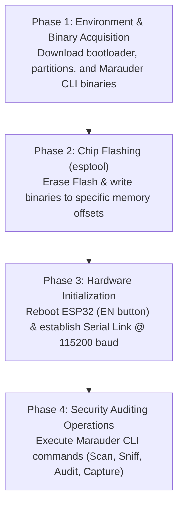

# ESP32 Marauder (Headless CLI) - Deployment, Workflow & Auditing Guide

A technical deployment guide and operational workflow manual for running the **ESP32 Marauder Security Auditing Suite** on the **ESP32 DevKit V1 (ESP-WROOM-32)** via a Headless Serial Command Line Interface (CLI).

---

## 1. Executive Summary & Purpose

The **ESP32 Marauder** (originally developed by *JustCallMeKoko*) is an open-source wireless security analysis suite designed for micro-controllers. While often deployed alongside external touchscreen modules (such as the Flipper Zero WiFi Devboard or LilyGO T-Display), this deployment focuses on the **Headless CLI configuration** on a standard ESP32 DevKit V1 board.

In this headless setup:
* No external LCD, SD card module, or peripheral buttons are required.
* Power and data communication occur over a single USB cable.
* Operations are managed via an interactive serial terminal (115200 baud).
* Provides a cost-effective, portable laboratory environment for wireless security testing, 802.11 frame inspection, and BLE auditing.

---

## 2. Hardware Profile & Target Specifications

| Parameter | Specification |
| :--- | :--- |
| **Board Name** | ESP32 DevKit V1 (30-pin layout) |
| **Core Microprocessor** | ESP-WROOM-32 (Xtensa Dual-Core 32-bit LX6 up to 240 MHz) |
| **Flash Memory** | 4 MB SPI Flash |
| **SRAM** | 520 KB |
| **USB-to-UART Bridge** | QinHeng Electronics USB Single Serial / CP2102 |
| **Linux Device Node** | `/dev/ttyACM0` (or `/dev/ttyUSB0`) |
| **Operating Voltages** | 5V USB Input / 3.3V Logic Level |
| **Physical Controls** | `EN` (Reset) & `BOOT` (GPIO 0 Download Mode) buttons |

---

## 3. End-to-End Workflow Architecture



### Workflow Breakdown

1. **Environment Preparation & Firmware Acquisition:**
   * Verify USB serial port connectivity and device permissions.
   * Acquire compatible ESP32 Marauder binary components:
     * `bootloader.bin` (Loads core system initialization at address `0x1000`)
     * `partitions.bin` (Defines SPI Flash memory partitioning at address `0x8000`)
     * `esp32_marauder_...bin` (Application binary loaded at address `0x10000`)

2. **Firmware Flashing via `esptool`:**
   * Put ESP32 into bootloader mode (`BOOT` button logic or automated DTR/RTS signalling).
   * Perform a clean erase of the SPI flash memory to eliminate lingering configurations.
   * Burn the binaries to their respective memory offsets using `esptool.py`.

3. **Reboot and Serial Terminal Connection:**
   * Press the `EN` button to boot into Marauder OS.
   * Open a serial terminal emulator at `115200` baud rate with local echo or ANSI support.

4. **Interactive Security Testing & Diagnostics:**
   * Perform reconnaissance against self-owned wireless access points.
   * Evaluate network management frame resilience (802.11w MFP).
   * Harvest PMKID hashes for offline dictionary verification.

---

## 4. Flashing Procedure & Technical Commands

### 4.1 Prerequisites
Ensure Python and `esptool` are installed, and user permissions allow access to the serial device node:

```bash
# Verify Python serial tool availability
pip install esptool pyserial

# Add user to dialout group (Linux permission for serial devices)
sudo usermod -aG dialout $USER
```

### 4.2 Step 1: Query Chip Information
Verify communication and read MAC address and flash size:

```bash
esptool.py --port /dev/ttyACM0 chip_id
```

### 4.3 Step 2: Erase Flash Memory
Erase existing firmware partitions to ensure a clean slate:

```bash
esptool.py --port /dev/ttyACM0 --baud 921600 erase_flash
```
*(If the connection times out, hold down the `BOOT` button on the board while the command initiates).*

### 4.4 Step 3: Flash the Firmware Binaries
Flash all three binary files to their designated memory locations:

```bash
esptool.py --port /dev/ttyACM0 --baud 921600 write_flash -z \
  0x1000 firmware/bootloader.bin \
  0x8000 firmware/partitions.bin \
  0x10000 firmware/esp32_marauder_vX.X_esp32_ldb.bin
```

---

## 5. Serial Interface & CLI Operation

Once flashing is complete, press the **`EN`** button on the ESP32. Open a serial connection at **115200 baud**:

```bash
# Using python miniterm:
python3 -m serial.tools.miniterm /dev/ttyACM0 115200

# Or using picocom / screen:
picocom -b 115200 /dev/ttyACM0
```

### Essential Marauder Command Reference

| Command | Function / Objective |
| :--- | :--- |
| `help` | Displays the complete list of available Marauder commands. |
| `scan ap` | Scans and enumerates nearby 2.4 GHz Access Points (SSID, BSSID, RSSI, Channel). |
| `list -a` | Displays the enumerated list of discovered Access Points with assigned index IDs. |
| `select -a <id>` | Selects a specific Access Point index for targeted testing. |
| `sniff pmkid` | Initiates PMKID harvesting against the selected target Access Point. |
| `sniff beacon` | Captures beacon management frames from surrounding networks. |
| `scan station` | Scans for active client stations associated with nearby networks. |
| `stopscan` | Halts any active scanning or sniffing routine. |
| `reboot` | Soft reboots the ESP32 microprocessor. |

---

## 6. Defensive Auditing Applications

1. **802.11w Management Frame Protection (MFP) Testing:**
   * Audit whether modern Access Points drop unauthenticated deauthentication frames.
   * Identifies legacy configuration gaps across enterprise and residential routers.

2. **PMKID Strength Auditing:**
   * Evaluate whether pre-shared keys (WPA2-PSK) are susceptible to dictionary attacks without disrupting connected users.

3. **Rogue AP Detection & Spectrum Reconnaissance:**
   * Identify unauthorized or spoofed Wi-Fi access points emitting overlapping SSIDs.

---

## 7. Ethics & Legal Compliance

> **IMPORTANT NOTICE:**  
> This documentation, firmware, and associated hardware are strictly for **independent educational research, personal self-study, and authorized defensive security assessments** conducted on privately owned networks or authorized lab environments.  
> Intercepting, disrupting, or targeting third-party networks without explicit authorization is strictly illegal under applicable national and international cybercrime legislation.
